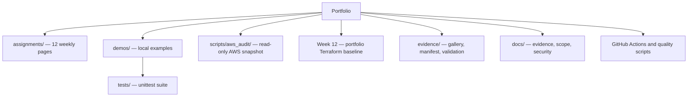

# AWS Cloud Engineering Portfolio
[](https://github.com/sameerhdevops/davine-aws-cloud-internship/actions/workflows/portfolio-quality.yml?query=branch%3Amain)
A 12-week record of AWS Cloud Engineering internship learning and the TalentFlow AI capstone. The repository brings together internship reports and console images described in its records, local demonstrations and tests, a read-only AWS posture snapshot tool, and a limited Terraform baseline built for this portfolio. It keeps the reported program schedule, available internship materials, added technical work, and deployment status distinct.
This is a personal portfolio. It is not an official Davine Technologies repository or company endorsement.
The supplied schedule details list **Weeks 1–11 marked Completed** and **Week 12 marked Current / Final Week**. A completed schedule week does not show that an assignment was submitted or accepted.
## Strongest inspectable work
- [Evidence gallery](evidence/README.md): selected screenshot crops with captions, context, and clear scope.
- [Read-only AWS audit](scripts/aws_audit/README.md): a boto3 snapshot of regional EC2/security-group settings and account-owned S3 bucket controls, with synthetic [JSON](samples/aws-audit-report.json) and [CSV](samples/aws-audit-report.csv) examples.
- [Six local demonstrations and tests](demos/README.md): VPC route/CIDR checks, health-threshold transitions, S3 event parsing, alarm arithmetic, idempotency, and a bounded S3 object-policy checker.
- [TalentFlow AI capstone](assignments/week-12-talentflow-ai/README.md): the proposed architecture, available project records, and the implementation boundary.
- [Week 12 Terraform](assignments/week-12-talentflow-ai/infrastructure/terraform/README.md): reviewable VPC, security-group, S3, IAM, logging, and monitoring configuration. It has not been applied to AWS.
The capstone illustration is a documented target design based on project descriptions. It is not an export from a deployed environment.

## Twelve-week map
The schedule column reports the information supplied for this portfolio. It is separate from available files and technical demonstrations. The [timeline](docs/internship-timeline.md) and [evidence guide](docs/EVIDENCE.md) explain how to read the records.
| Week | Focus | Reported schedule | Page and inspectable work |
| --- | --- | --- | --- |
| 1 | AWS cloud fundamentals | Completed | [Week 1](assignments/week-01-aws-fundamentals/README.md) |
| 2 | EC2 and host-level security | Completed | [Week 2](assignments/week-02-ec2-web-server/README.md) · [screenshot](evidence/README.md#week-2-ec2-and-host-level-security) |
| 3 | VPC networking | Completed | [Week 3](assignments/week-03-vpc-networking/README.md) · [CIDR and route demonstration](demos/week03_vpc/validate.py) |
| 4 | Application Load Balancing | Completed | [Week 4](assignments/week-04-application-load-balancing/README.md) · [health-threshold example](demos/week04_alb/health_threshold.py) |
| 5 | High availability and Auto Scaling | Completed | [Week 5](assignments/week-05-high-availability/README.md) · [architecture diagram](diagrams/week-05-high-availability.svg) |
| 6 | Serverless architecture | Completed | [Week 6](assignments/week-06-serverless-architecture/README.md) · [S3 event parser](demos/week06_serverless/handler.py) |
| 7 | Infrastructure as Code | Completed | [Week 7](assignments/week-07-infrastructure-as-code/README.md) · [console crop](evidence/README.md#week-7-infrastructure-as-code) |
| 8 | Observability, DNS, and CDN | Completed | [Week 8](assignments/week-08-monitoring-cdn-dns/README.md) · [alarm arithmetic](demos/week08_observability/alarm_math.py) |
| 9 | Serverless integration and scaling | Completed | [Week 9](assignments/week-09-serverless-api/README.md) · [idempotency example](demos/week09_integration/idempotency.py) |
| 10 | Governance, security, and cost | Completed | [Week 10](assignments/week-10-governance-audit/README.md) · [policy checker](demos/week10_governance/policy_check.py) |
| 11 | Capstone briefing and planning | Completed | [Week 11](assignments/week-11-capstone-planning/README.md) · briefing context, not a Week 11 assignment |
| 12 | TalentFlow AI capstone | Current / Final Week | [Week 12](assignments/week-12-talentflow-ai/README.md) · [portfolio Terraform baseline](assignments/week-12-talentflow-ai/infrastructure/terraform/README.md) |
The supplied schedule details also report **92% progress** and “No weekly submissions yet” in the submission-history panel. No portal screenshot or export is in this repository.
## Reproduce the local checks
Prerequisites: Python 3.11 or newer, Git, and (for Terraform checks) Terraform 1.16.5. From the repository root:
```powershell
python -m venv .venv
.venv\Scripts\python -m pip install -r requirements-dev.txt
.venv\Scripts\python -m unittest discover -s tests -v
.venv\Scripts\python demos/week03_vpc/validate.py
.venv\Scripts\ruff check demos scripts tests
.venv\Scripts\ruff format --check demos scripts tests
.venv\Scripts\python scripts/check_markdown_links.py
.venv\Scripts\python scripts/check_portfolio.py
.venv\Scripts\python -m compileall -q demos scripts tests
```
The demonstrations and audit tests use synthetic data and make no AWS API calls. To inspect the audit command options without credentials, run:
```powershell
.venv\Scripts\python -m scripts.aws_audit.cli --help
```
The optional audit uses read-only APIs and should only run with an appropriately scoped profile. Real reports can contain resource identifiers and should remain private. See the [audit guide](scripts/aws_audit/README.md).
From the portfolio Terraform directory, the safe static checks are:
```powershell
terraform fmt -check
terraform init -backend=false -input=false -lockfile=readonly
terraform validate
```
## What the records establish
- The supplied schedule details list Weeks 1–11 as Completed, Week 12 as Current / Final Week, 92% progress, and “No weekly submissions yet.” They do not establish assignment submission or acceptance.
- Existing repository notes identify the duplicated 34-page Week 11/12 architecture PDF as a Week 12 capstone briefing, not a Week 11 task. The source files are not in the repository, so their contents, page count, and duplicate relationship cannot be confirmed from the published files.
- The published screenshot crops depict console views at their capture times. Their match to private originals and the completeness of any redaction have not been checked against the originals.
- The TalentFlow AI application and its original infrastructure source are not in the tracked repository. The proposed architecture is separate from the smaller Terraform baseline.
- The Terraform defines selected network, security-group, S3, IAM, CloudWatch, and SNS resources. It does not provision the application instances, ALB, database, Lambda/API, or a log producer, and it has not been applied.
- See [scope](docs/SCOPE.md), [evidence guide](docs/EVIDENCE.md), [security notes](docs/SECURITY-NOTES.md), and [validation records](evidence/validation/README.md).
## Repository map

The [diagram source](diagrams/repository-structure.mmd) and [Terraform security-group/network diagram](assignments/week-12-talentflow-ai/infrastructure/terraform/architecture.mmd) are also available as files.
## Project context and contact
The repository distinguishes internship reports and console images described in its records, added local work, designs based on available project descriptions, and checks run against specific code or configuration. These categories do not establish who authored a file or that it was deployed. The [evidence gallery](evidence/README.md) includes captions and a [file-level manifest](evidence/manifest.csv).
AI tools assisted with parts of the implementation and documentation. I review the project, test its behavior, and am responsible for explaining the work I present.
GitHub profile: [sameerhdevops](https://github.com/sameerhdevops).
