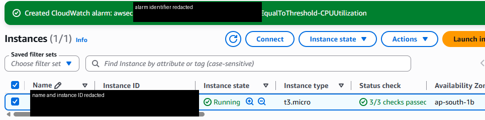

# Week 2 — EC2 and host-level security

## Objective

I wanted to explore a small EC2 web host, Linux access, instance-health signals, and the security choices that shape exposure.

## What I did or implemented

The portfolio’s Week 2 notes describe a `t3.micro` in the running state, three passing instance status checks in one capture, an alarm-creation notice, a simple web page, and an Elastic IP association. They also describe SSH restricted to one `/32` and HTTP open on port 80 for the web exercise. A separate launch form warned about SSH from `0.0.0.0/0`, but the available notes do not connect that form to the instance shown.

## Key concepts

- **Instance versus application health:** Passing platform checks does not confirm that a process, listener, or web response is healthy.
- **Ingress scope:** Restrict administration access; open only the application ports the exercise needs, and verify which rules were actually attached.
- **Cost and cleanup:** A running instance and an Elastic IP can incur charges, so a lab needs a clear shutdown and address-release step.

## Evidence and links

*The crop shows a point-in-time console view; it does not show alarm evaluation or notification delivery.* See the [gallery entry](../../evidence/README.md#week-2-ec2-and-host-level-security) and [manifest](../../evidence/manifest.csv).

## Limitations

No user-data script, web-root content, security-group source, or Terraform configuration for this exercise is in the repository. The notes and image do not establish present AWS state, a functioning alarm, or assignment submission or acceptance.

## Next improvements

A local host lab could define a minimal web server and security group, restrict SSH to a test CIDR, and check host and application health separately.
