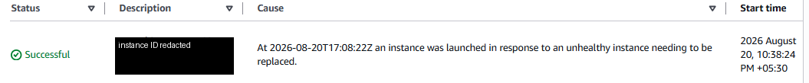

# Week 5 — High availability and Auto Scaling

## Objective and architecture

The recovered exercise explored an internet-facing Application Load Balancer forwarding HTTP traffic to an instance target group, with EC2 capacity managed by an Auto Scaling group across Availability Zones. The explanatory [diagram](../../diagrams/week-05-high-availability.svg) is an independent redraw, not an AWS export.

*Sanitized derivative of an original Week 5 console capture (2026-08-20). It records one successful replacement activity whose cause mentions an unhealthy instance. It does not establish sustained availability, all targets healthy, or current state.*

## Recovered internship evidence

**Original internship artifacts:** an August report, diagram, ALB/target-group/launch-template/Auto Scaling captures, and a browser response were found. One target-group capture shows two registered targets: one healthy and one unhealthy. The ALB-detail capture was still `Provisioning`; it must not be described as active based on that screenshot. The published crop was selected because it shows the replacement event clearly and avoids exposing instance IDs.

**Portal schedule:** Week 5 is marked Completed as reported by the user. There is no saved portal screenshot/export, and the supplied portal history says “No weekly submissions yet.” Retained technical artifacts do not independently prove portal submission or review.

## Decisions and failure behavior

The pattern separates the public listener from instance targets and uses a launch template and desired/minimum/maximum group capacity. Health checks give the load balancer a routing signal; Auto Scaling has its own replacement policy and activity history. Multi-AZ placement reduces a single-zone dependency but does not remove application, database, DNS, quota, or deployment failure modes. A target can be unhealthy during bootstrap or because of an incorrect path, port, security group, or process.

Operationally, compare the target’s health reason, instance status checks, application logs, and scaling activity before changing capacity. Scaling increases can raise compute, load-balancer, and data-transfer charges; set bounds and alarms and plan cleanup.

“The screenshot shows an unhealthy target followed by a successful replacement event. It demonstrates one recovery action, not a measured availability SLO. I would still verify replacement health and the end-to-end response.”

## Reproduction and limits

The historical AWS environment cannot be reproduced from this repository because the launch template, target configuration, application source, and IaC were not retained. The local [Week 4 health-threshold demo](../week-04-application-load-balancing/README.md) is only a conceptual state machine. See the [gallery](../../evidence/README.md#week-5-high-availability-and-auto-scaling) for the exact crop and limitations.

Next: [Week 6 — serverless architecture](../week-06-serverless-architecture/README.md).
