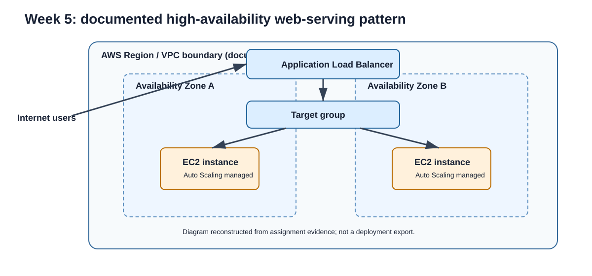

# Week 5 - High availability and Auto Scaling

## Evidence status

**Verified complete.** A recovered Week 5 technical report, a diagram, a rendered browser page, and related console captures establish the exercise. They are retained privately.

## Objective

Explore a multi-AZ web-serving pattern that distributes traffic through an ALB and manages instance capacity through an Auto Scaling group.

## Architecture represented

The original diagram above is a documentation reconstruction, not a deployment export. It represents internet ingress through an ALB, routing to a target group, and application instances in multiple availability zones managed by Auto Scaling.

## Evidence-backed observations

- Launch-template, target-group, load-balancer, and Auto Scaling screens were captured.
- A browser capture showed a high-availability web page served through a load-balancer hostname.
- Target-health and scaling-activity views were captured, including a historical unhealthy target state.

## Limitations and lessons

No load-balancer configuration, launch template, health-check configuration, or server code is retained. The material is useful as architecture and validation evidence but cannot reproduce the environment. Target health is operational evidence at capture time, not proof of continuous availability.
