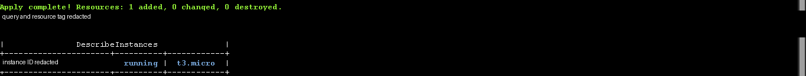

# Week 7 — Infrastructure as Code

## Objective and recovered evidence

The recovered September 4 report and screenshots discuss Terraform/CloudFormation and show an EC2 workflow. The selected historical CloudShell crop contains `Apply complete! Resources: 1 added, 0 changed, 0 destroyed` followed by an `aws ec2 describe-instances` result showing one `t3.micro` in `running` state. The instance identifier and query/tag details were removed.

*Original internship screenshot, published as a sanitized derivative (2026-09-04). This is a historical capture of a Week 7 lab; it is not validation or deployment evidence for the independent Week 12 Terraform code.*

**Portal schedule:** Week 7 is marked Completed as reported by the user. No portal screenshot/export was located; the supplied submission history says “No weekly submissions yet.”

## Technical judgment and security finding

The local file set does not contain the raw Week 7 `.tf`/YAML templates, so the historical apply cannot be reproduced or reviewed for drift, state safety, or full resource scope. A separate original launch-form capture displays SSH ingress from `0.0.0.0/0` and AWS’s warning that it allows access from all IP addresses. It is not evidence that this rule was applied to the Terraform-created instance, but it is a genuine unsafe configuration shown during the same learning period; it is withheld from the public gallery and documented as a security lesson. Prefer a managed access channel or tightly scoped temporary ingress, and never commit state, credentials, or real variable files.

“A successful apply only says Terraform completed its requested changes. I would also review the plan, state handling, post-apply health, IAM scope, ingress, and cleanup. Here the screenshot supports one historical resource creation, not the Week 12 project.”

## Reproduction and limits

No original Week 7 source is available to rerun. The separate [Week 12 Terraform baseline](../week-12-talentflow-ai/infrastructure/terraform/README.md) is independently reconstructed and has its own format/init/validate record; it has not been applied. See the [gallery](../../evidence/README.md#week-7-infrastructure-as-code) and [portfolio provenance map](../../docs/portfolio-map.md).

Next: [Week 8 — observability, DNS, and CDN](../week-08-monitoring-cdn-dns/README.md).
