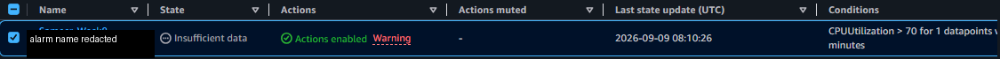

# Week 8 — Observability, DNS, and CDN

## Objective

Review CloudWatch metrics and alarms alongside CloudTrail, Route 53, and CloudFront, with attention to what an alarm state can and cannot tell an operator.

## What I did or implemented

The retained brief and September report cover these services. The report notes that CloudTrail, Route 53, and CloudFront captures were missing. The available portal information marks Week 8 Completed and separately reports “No weekly submissions yet”; no portal screenshot or export is retained.

The added [alarm_math.py](../../demos/week08_observability/alarm_math.py) calculates a numeric M-of-N threshold result over a short datapoint list.

## Key concepts

An alarm state depends on metric publication, dimensions, period, evaluation windows, threshold, and missing-data treatment. An Insufficient data state does not mean that a threshold was breached. Check metric delivery, configuration, and alarm history before concluding that an alert worked.

Choose a signal tied to user impact, then set a threshold using baseline and service-level context. Costs can include alarms, custom metrics, dashboards, logs, ingestion, Route 53 queries, CloudFront requests, and data transfer.

## Evidence and links

*Sanitized derivative described in the existing portfolio record as an original screenshot dated 2026-09-09. It shows the selected threshold and state at capture time, not a breach, delivered notification, or present monitoring state.* See the [gallery entry](../../evidence/README.md#week-8-observability-dns-and-cdn) and [demo catalog](../../demos/README.md).

## Limitations

The local example is a reproducible demonstration, not CloudWatch emulation. It does not model aggregation, alarm timing, missing-data configuration, metric delivery, or actions. The report-described DNS/CDN topics do not have corresponding screenshots in the repository.

## Next improvements

Add a small test matrix for missing and incomplete datapoints, then document how an operator would verify metric dimensions and alarm history before changing a threshold.
