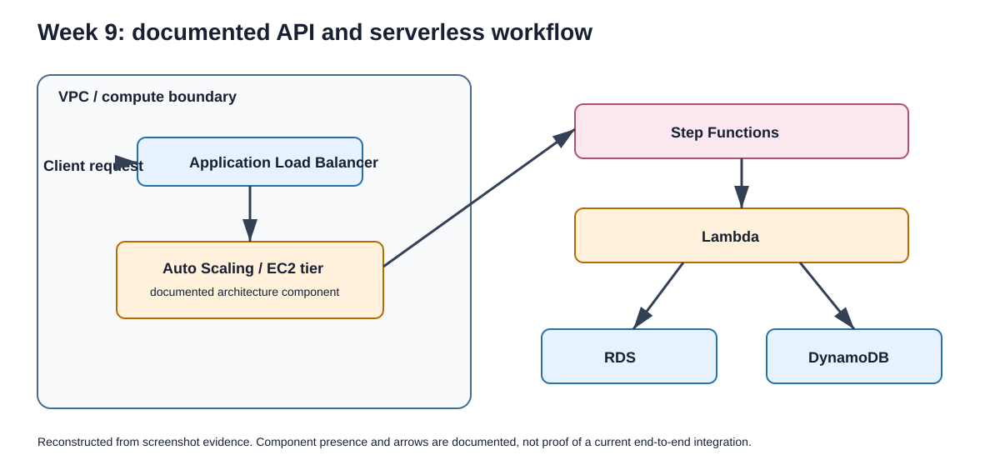

# Week 9 - Serverless API workflow

## Evidence status

**Confirmed internship evidence.** A final activity architecture diagram and API-result capture explicitly reference Week 9.

## Documented architecture

The evidence depicts an API-facing workflow involving an Application Load Balancer, Auto Scaling/EC2 tier, Step Functions, Lambda, RDS, and DynamoDB. The diagram labels the data layer as verified resources but does not assert an end-to-end application-to-database call.

## Validation evidence

- A Lambda console test result was captured.
- A browser showed a successful API response.
- Console views for an ALB, Auto Scaling group, and DynamoDB table were captured.

## Limitations

No Lambda source package, API definition, state-machine definition, database schema, or integration code is included. The available evidence supports individual workflow components and a documented architecture, not a complete reproducible application.

The mission references `AWS_Week9_Task_Submission_Clean.pdf` as supporting material, but that file was not available locally and was not used for this documentation.
