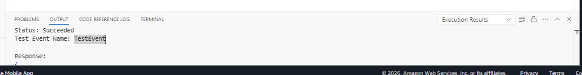
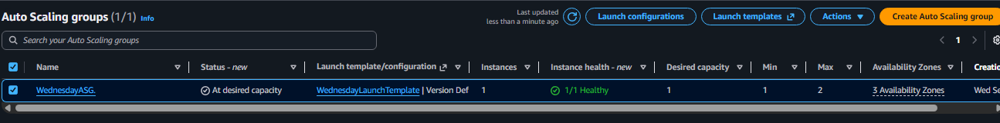

# Week 9 — Serverless integration and scaling

## Objective

I wanted to trace a web request and an event-driven API workflow across service boundaries, then reason about retries, state, scaling, and monitoring.

## What I did or implemented

The Week 9 activity reports described in the portfolio cover a web path using Route 53, an ALB, Auto Scaling, and EC2, plus an API path using API Gateway, Lambda, and DynamoDB; RDS and workflow topics also appear. The reports describe a successful Step Functions test and an Available RDS state, but their source code is not in this repository. The [workflow diagram](../../diagrams/week-09-serverless-api.svg) explains the flow, and the local [idempotency example](../../demos/week09_integration/idempotency.py) reuses a result for repeated same-key requests in process memory.

## Key concepts

- **API and data design:** Validate requests at the boundary and choose DynamoDB partition keys around expected access patterns; conditional writes can help make retries safe.
- **Signals across services:** Monitor API errors and latency, Lambda errors and throttles, queue age, and downstream saturation as one workflow.
- **Idempotency scope:** Process-local memory can reuse a result inside one process, but it is not durable, shared across processes, or an exactly-once guarantee.

## Evidence and links

*The capture date is unknown and the crop shows a console test result only; it does not establish API integration or end-to-end behavior.*

*The capture date is unknown; this point-in-time view does not establish continuous availability or prove the Week 5 environment.* See the [gallery](../../evidence/README.md#week-9-serverless-integration-and-scaling), [demo catalog](../../demos/README.md), and [tests](../../tests/test_labs.py).

## Limitations

The idempotency example uses process-local memory. It is not durable, shared across processes, or an exactly-once guarantee. Historical endpoint URLs, resource IDs, and table data are not published. The screenshots do not establish that services remain available, and the visible DynamoDB example row is not published.

## Next improvements

A follow-up could use a local durable store or conditional-write interface to test retries across process restarts.
