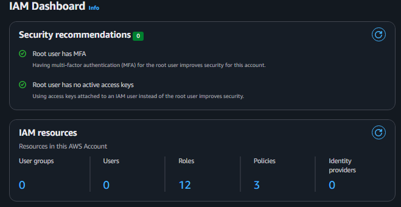
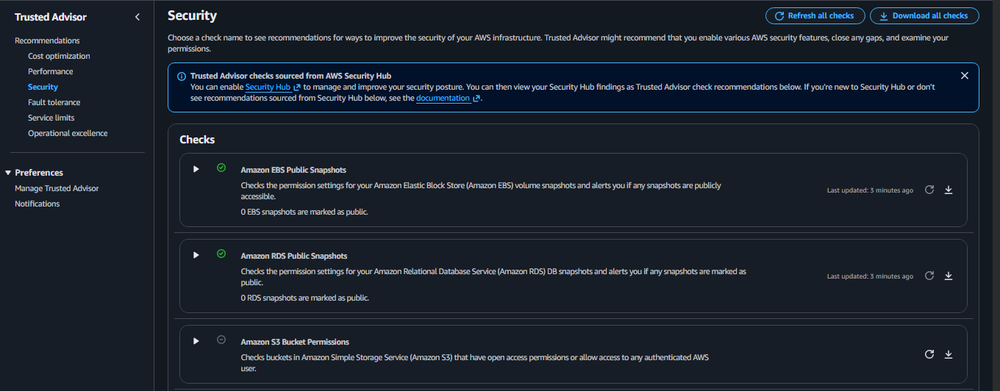

# Week 10 — Governance, security, and cost

## Objective and recovered evidence

The recovered audit/activity reports and screenshots cover IAM root-account signals, Trusted Advisor snapshot checks, Well-Architected review state, and billing views. The [cross-cutting review](../../cross-cutting/aws-security-governance-cost/README.md) records the distinctions and conflicting observations. Two safe console crops are embedded below so evidence is visible within the weekly page.

### Root-account control summary

*Sanitized derivative of an original screenshot; capture date unknown. It shows dashboard-reported root controls only, not who set them, present account state, or least privilege for other identities.*

### Trusted Advisor public snapshot checks

*Sanitized derivative of an original screenshot; capture date unknown. It does not establish a clean account-wide review or the unexpanded S3 check.*

**Portal schedule:** Week 10 is marked Completed as reported by the user. No portal screenshot/export was found, and the supplied submission history says “No weekly submissions yet.”

## Important interpretation and static policy example

The Well-Architected console capture shows 0 of 57 questions answered and 0 issues recorded; it does not support a claim that a review was completed. Billing captures show different contexts: one selected Cost Explorer view reports $0 for its date/filter selection, while a budget view reports spend above its $1 budget and a higher forecast. Those figures are not merged into one cost claim. The audit report and dashboard also differ on some root-account details; capture time and account context are not sufficient to establish a single current state. Billing and raw review screenshots are withheld because they expose account-specific financial or identifying information.

[`example-policy.json`](../../demos/week10_governance/example-policy.json) and [`policy_check.py`](../../demos/week10_governance/policy_check.py) demonstrate a bounded static check: policy Version `2012-10-17`, explicit `Allow`, the `s3:GetObject`/`s3:PutObject` object-action allow-list, and named-bucket object ARNs. Wildcard bucket scope and unsupported fields such as conditions or principals are rejected. The bucket-name parser accepts a documented subset of general-purpose bucket names; it is not a complete AWS naming validator. Run `python -m unittest discover -s tests -v`. Passing is **not** IAM simulation, Access Analyzer, or an authorization result, and the checker is not a security gate for real policies.

Use budgets and alerts before labs, tag owners/environment, identify idle public IPs and endpoints, and include teardown. For access review, evaluate identity/resource policies, trust relationships, conditions, boundaries, SCPs, and effective permissions—not only one dashboard tile.

“I would preserve the review scope and timestamp, distinguish a zero-finding snapshot from a completed assessment, and validate spend with the selected period and filters before drawing a conclusion.”

See the [gallery](../../evidence/README.md#week-10-governance-security-and-cost), [cross-cutting review](../../cross-cutting/aws-security-governance-cost/README.md), and [demo catalog](../../demos/README.md).

Next: [Week 11 — capstone briefing and planning](../week-11-capstone-planning/README.md).
