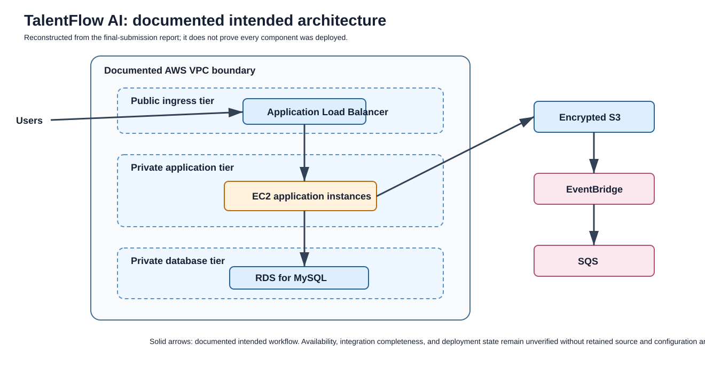

# Week 12 - TalentFlow AI capstone

## Evidence status

**Documented capstone architecture and implementation work; not a reproducible source repository.** The available artifact is a 13-page final-submission report for a Davine Technologies internship capstone. The reported effort was approximately two weeks.

## Intended purpose

TalentFlow AI is described as a cloud-native talent-acquisition and recruitment workflow. The report says it is intended to support applicant tracking, resume ingestion, pipeline state management, interview scheduling, and recruitment analytics.

## Intended users and workflow

The documented flow is:

1. A browser reaches an internet-facing Application Load Balancer.
2. The load balancer routes traffic to application instances in private subnets.
3. The application tier reads/writes structured records to a private relational database.
4. Resume files are sent to private encrypted object storage.
5. An event-driven path is described in which storage activity triggers EventBridge and queues asynchronous work in SQS.

This is an original explanatory diagram reconstructed from the report. Solid arrows represent the documented intended flow. It is **not** a deployment diagram or proof that every component was provisioned.

## Technologies discussed in the report

AWS VPC, subnets, security groups, EC2, Application Load Balancer, Amazon S3, Amazon RDS for MySQL, Amazon SQS, Amazon EventBridge, IAM, CloudWatch, SNS, Terraform, Git, GitHub, and a local development environment.

## What the report directly supports

| Area | Evidence level | What can be stated safely |
| --- | --- | --- |
| Architecture | Documented claim | The report describes a multi-tier AWS design and its intended network/data flow. |
| Local application checks | Documented claim | The report says authentication and dashboard/pipeline views were checked locally. Application source is absent. |
| IaC | Documented claim plus capture-time evidence | The report describes Terraform definitions and validation. The available materials do not include the modules. |
| Cloud configuration | Capture-time report evidence | The report includes console evidence for selected networking, storage, identity, monitoring, and alerting items. It does not establish current state. |
| SNS delivery | Explicitly limited | The report says a subscription was pending confirmation; successful alert delivery is not claimed. |

## Read-only source-repository investigation

The supplied TalentFlow AI repository lead was accessible and reviewed without cloning, running, copying, or modifying its contents. It is a public static frontend repository containing HTML, CSS, JavaScript, and an image; no licence file, backend, Terraform/IaC, cloud configuration, build manifest, or deployment guide was found.

The frontend supports a recruitment-interface prototype with candidate, job, interview, dashboard, and browser-local demo behaviour. It does **not** establish a deployed AWS multi-tier system, database persistence, real AI/model integration, server-side authentication, event processing, or the report's cloud-infrastructure claims. The repository includes demo authentication material, which is intentionally neither repeated nor used by this portfolio. Because no licence was found, its code and assets are not copied here.

## Components that remain unverified or missing

- Original application source code and dependency manifest
- Terraform modules, provider versions, variables, state, and sanitized plan
- Database schema, migrations, seed data, and application-to-database integration code
- API/UI source and local test procedure
- EventBridge rule, SQS consumer/worker, and end-to-end resume-ingestion proof
- Sanitized deployment record and teardown/cost-control record
- Authorized source-code publication permission and contribution/ownership boundaries

The report says a codebase was cloned from a Davine Technologies version-control repository. The accessible repository above is a relevant lead, but it is not sufficient to attribute all source authorship or to publish company-owned code. No project checkout was located in the supplied directory.

## Report quality notes

The PDF has irregular pagination/section ordering in its extracted content: a references page appears before subsequent challenge/learning/conclusion material, then references recur. This portfolio preserves the technical reading while flagging the document-structure issue rather than silently correcting it.

## Safe interview framing

> TalentFlow AI is a documented capstone architecture and validation portfolio piece. I can explain the intended AWS design, security boundaries, and evidence captured during the internship. I do not present it as a runnable, independently authored, or currently deployed application because the retained source artifacts are unavailable.

## How to strengthen this capstone later

1. Obtain written publication approval from the project owner.
2. Recover a sanitized, authorized copy of the source repository and record ownership/contribution boundaries.
3. Add a reproducible local setup guide, architecture decision log, and redacted IaC examples.
4. Add tests or a controlled validation record that distinguishes local behavior, plans, and deployed resources.
5. Recheck every screenshot for identifiers/endpoints before adding it to a public repository.
