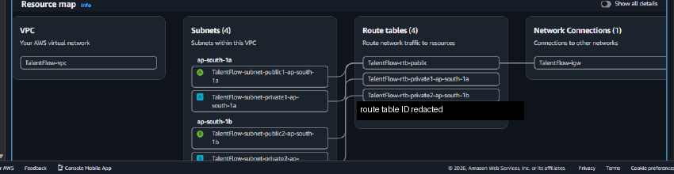

# Week 12 — TalentFlow AI capstone

## Objective

I wanted to understand the TalentFlow AI recruitment and talent-management goal, describe its proposed service flows, and distinguish that design from the smaller Terraform project available in this portfolio.

## What I did or implemented

The portfolio’s project notes describe a report titled “Final Submission,” an architecture briefing, and selected console images. The source documents are not in the repository, so their exact contents and relationship cannot be confirmed from the public files; the report title alone does not show that work was uploaded or accepted. The internship tracker shows Week 12 as Current / Final Week, with “No weekly submissions yet” in the submission-history panel. The proposed browser path connects DNS/CDN and an ALB to application and relational-data tiers, with S3 for resumes and API/Lambda plus event services for selected workflows. The [architecture diagram](../../diagrams/talentflow-intended-architecture.svg) is a design, not a deployment export. The [Terraform README](infrastructure/terraform/README.md) describes a portfolio baseline with a VPC, Internet Gateway, four subnets, route tables, S3 gateway endpoint, tiered security groups, a private versioned and encrypted S3 bucket, an EC2-trust IAM role and instance profile, a CloudWatch log group, SNS topic, and daily S3 storage alarm. It does not create EC2 instances, an ALB/listener, RDS, the application, Lambda, a queue, API Gateway, or a log producer; the SNS topic has no subscription, and the configuration has not been applied to AWS.

## Key concepts

- **Network paths:** Public subnets have an Internet Gateway route; private subnets have an S3 gateway endpoint and no general Internet egress in this baseline.
- **Layered access:** Security groups separate the load-balancer, application, and database tiers; the S3 bucket blocks public access, enables SSE-S3 and versioning, and requires TLS in its bucket policy.
- **Operational scope:** The instance profile is declared but has no instance attached; the log group has no producer, the storage metric is daily, and a topic without a confirmed subscription does not demonstrate message delivery.

## Evidence and links

*The crop shows a console map, not that this portfolio’s Terraform created the VPC or that an application ran there.* See the [evidence gallery](../../evidence/README.md#week-12-talentflow-ai-capstone), [manifest](../../evidence/manifest.csv), and [Terraform project](infrastructure/terraform/README.md).

## Limitations

The original TalentFlow AI application and original infrastructure source are not in the repository, and the baseline has not been applied. The portfolio does not establish a deployed application, end-to-end API integration, notification delivery, or current AWS state. `BucketSizeBytes` is a daily metric rather than real-time monitoring; the log group has no producer, and private workloads have no general Internet egress for package repositories.

## Next improvements

For future study, I would define API and data contracts, test retry and idempotency behavior, and review private egress, logging, retention, and cost before considering any authorized deployment.
