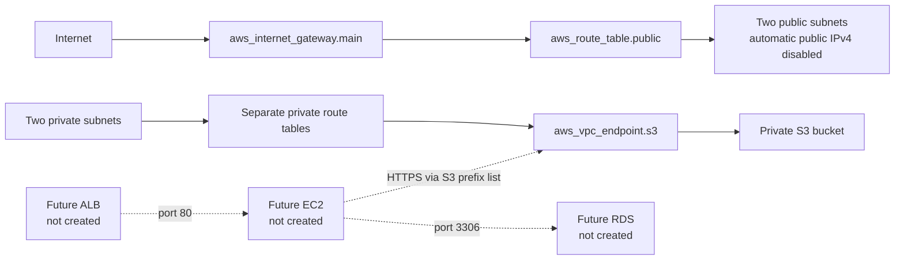

# TalentFlow AI — reconstructed Terraform baseline

This repository contains a Terraform reconstruction for portfolio study. It is **not** recovered Week 7 or Week 12 source, and it has not been applied to AWS. The [architecture diagram](architecture.mmd) describes only resources declared by this configuration and labels future application tiers separately. “Reconstruction” describes provenance, not personal authorship; see the [evidence policy](../../../../docs/EVIDENCE.md).

## Declared resource map

| Layer | Terraform resources | Purpose and boundary |
| --- | --- | --- |
| Network | `aws_vpc.main`, `aws_internet_gateway.main`, `aws_subnet.public`, `aws_subnet.private`, route tables, associations, `aws_vpc_endpoint.s3` | Two public and two isolated private subnets; no NAT Gateway or application workload. |
| Security groups | `aws_security_group.alb`, `.ec2`, `.rds` and standalone ingress/egress rules | Models future ALB → EC2 → RDS flows. The groups are not attached to created compute resources. |
| Object storage | `aws_s3_bucket.resumes` plus ownership, public-access-block, policy, versioning, encryption, and lifecycle resources | Private versioned bucket with SSE-S3, TLS-only bucket policy, and noncurrent-version cleanup. |
| Identity | `aws_iam_role.ec2_s3_role`, `aws_iam_role_policy.ec2_s3_least_privilege`, `aws_iam_instance_profile.ec2_profile` | EC2 trust and bucket/object-scoped read permissions; no instance is created or attached. |
| Monitoring and notification | `aws_cloudwatch_log_group.app_logs`, `aws_cloudwatch_metric_alarm.storage_warning`, `aws_sns_topic.alerts` | Seven-day log retention and a daily S3 storage metric alarm. No log producer or SNS subscription is defined. |

The [resource diagram source](architecture.mmd) provides the relationships. Its future workload components are explicitly not provisioned here.



## What the configuration declares

- One VPC, an Internet Gateway, two public subnets with an Internet Gateway default route, and two private subnets with separate route tables, local routes, and an S3 gateway endpoint association.
- An S3 gateway endpoint associated with both private route tables. It keeps the modeled bucket path private without a NAT Gateway.
- Three security groups modelling a future ingress → application → database chain. Egress is scoped to the next tier’s security group or the regional S3 prefix list. These are rules and groups only: there is **no** Application Load Balancer, EC2 instance, RDS instance, target group, listener, or application.
- A private S3 general-purpose bucket with all four Block Public Access settings, bucket-owner-enforced ownership, versioning, SSE-S3 (`AES256`), a deny policy for insecure transport, and a lifecycle rule for incomplete uploads and noncurrent versions. The example bucket name must be replaced by an available, globally unique name before any real deployment.
- An EC2-trust IAM role, a bucket-scoped read-only policy, and an instance profile for a future EC2 workload. No instance is created or attached.
- A CloudWatch log group with bounded retention, an SNS topic, and a daily S3 `BucketSizeBytes` alarm for `StandardStorage`. No log producer, notification subscription, or application is configured.

## Network boundary

The public route table has `0.0.0.0/0` through the Internet Gateway, but `map_public_ip_on_launch` is disabled. The setting prevents automatic public IPv4 assignment to instances launched in those subnets; it does not itself give an instance a public address or guarantee that other resources and addresses will not incur public IPv4 charges. Any future public-facing tier needs an explicit addressing/load-balancing design. Check [current Amazon VPC pricing](https://aws.amazon.com/vpc/pricing/) before any separately approved deployment.

Each private subnet has its own route table. An S3 gateway endpoint adds the service prefix-list route to those private tables so a future role-attached instance can reach S3 without NAT or public Internet egress. The EC2 security group permits HTTPS to that S3 prefix list only. ALB-to-application and application-to-database egress are scoped to the corresponding destination security groups. The private tiers still cannot reach public package repositories or arbitrary public AWS endpoints; adding those paths would require an explicit, reviewed egress design. AWS documents that S3 gateway endpoints have no additional endpoint charge, while normal S3 request, storage, and data-transfer pricing still applies ([AWS endpoint guide](https://docs.aws.amazon.com/vpc/latest/privatelink/gateway-endpoints.html)).

The sample subnet CIDRs were checked for containment in the default VPC range and for overlap with one another. Variable validation checks CIDR syntax and distinct entries, but does not compare overridden subnet ranges with each other or with an overridden VPC range. Review containment and overlap manually before using changed CIDRs.

The ALB, EC2, and RDS security groups are preparatory configuration resources. Their rules do not expose a running load balancer, application, or database because this configuration creates no matching compute, load-balancer, or database resources. The security-group resources omit inline rules and use standalone ingress/egress rule resources. The locked AWS provider v5.100.0 documentation says Terraform removes AWS's initial allow-all egress rule when it creates a VPC security group; the declared standalone rules therefore express the scoped egress described above. The RDS security group has no explicit egress rule. See the [versioned provider reference](https://registry.terraform.io/providers/hashicorp/aws/5.100.0/docs/resources/security_group#note-on-egress-rules) and [AWS security-group rule behavior](https://docs.aws.amazon.com/vpc/latest/userguide/creating-security-groups.html).

## Security and cost considerations

- Replace `s3_bucket_name` in [`terraform.tfvars.example`](terraform.tfvars.example) with an available, globally unique name before any real deployment. Never commit credentials, account IDs, state files, or a real `.tfvars` file.
- `aws_region` is checked for an AWS-style identifier shape only; the variable check does not establish that a region exists, is enabled, or is supported by an account.
- The variable check deliberately accepts a subset of S3 general-purpose bucket names: 3–63 lowercase letters/digits with internal hyphens, excluding AWS-reserved prefixes/suffixes and account-regional `-an` names. It excludes dotted names and cannot check global uniqueness. Compare with the [full AWS naming rules](https://docs.aws.amazon.com/AmazonS3/latest/userguide/bucketnamingrules.html).
- SSE-S3 is deliberately selected. S3 Bucket Keys apply to SSE-KMS, so `bucket_key_enabled` is omitted from this SSE-S3 configuration. See the [AWS S3 Bucket Keys guide](https://docs.aws.amazon.com/AmazonS3/latest/userguide/bucket-key.html) and the [Terraform provider resource reference](https://registry.terraform.io/providers/hashicorp/aws/latest/docs/resources/s3_bucket_server_side_encryption_configuration).
- The bucket enforces public-access blocks, bucket-owner-enforced ownership, and TLS-only transport through an explicit deny policy. The IAM role is scoped to list/read operations on this bucket. The role is not attached to a created instance.
- The S3 `BucketSizeBytes` metric is daily and supports the `Average` statistic for the `StandardStorage` dimension, so the alarm is not a real-time storage monitor. It requires the bucket's daily metric data to arrive. The resource treats missing data as not breaching, so it does not detect a missing metric stream. The SNS topic has no subscription, so no recipient is configured. See [S3 metric dimensions](https://docs.aws.amazon.com/AmazonS3/latest/userguide/metrics-dimensions.html) and the [alarm configuration](main.tf).
- If applied, S3 storage, requests, retained object versions, CloudWatch alarm/log ingestion and retention, SNS delivery, and any future network or compute resources can incur charges. The configured S3 gateway endpoint has no additional endpoint charge; it does not make S3 operations free. This project makes no precise cost estimate. Check current AWS pricing before any separately authorized deployment.
- No AWS credentials are needed for formatting or provider-schema validation. `terraform init -backend=false` may download the provider, but does not configure a remote state backend.

## Local validation

From this directory, the safe static checks are:

```powershell
terraform fmt -check
terraform init -backend=false -input=false -lockfile=readonly
terraform validate
```

See the [validation index](../../../../evidence/validation/README.md) for commit-scoped local and hosted results. The previous Windows Terraform validation passed formatting and backend-free initialization but failed before the provider returned a schema; hosted Ubuntu validation passed for its recorded commit. These checks do not produce an AWS plan or prove deployed resources.

The portfolio checks are limited to formatting, backend-free initialization, and static validation. Do not run `terraform plan`, `terraform apply`, or `terraform destroy`. A separately recorded earlier plan invocation failed before producing a plan because valid AWS credentials were unavailable. No cloud resource should be created to inspect or validate this code.

## Files

- [Architecture source](architecture.mmd)
- [Provider/version constraints](versions.tf)
- [Inputs](variables.tf) and [safe example values](terraform.tfvars.example)
- [Resources](main.tf) and [outputs](outputs.tf)
- [Terraform-specific ignore rules](.gitignore)
- [Future sandbox runbook](sandbox-runbook.md)
- [Future sandbox evidence checklist](validation-checklist.md#future-sandbox-evidence-checklist)
