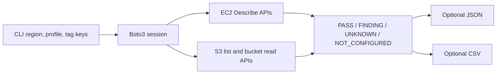

# Read-only AWS posture snapshot

This small boto3 CLI checks active EC2 instances and security groups in one Region, plus general purpose S3 buckets owned by the caller across the account. It reads configuration only and does not change AWS resources.

## Setup

From the repository root, use Python 3.11 or newer:

```powershell
python -m venv .venv
.venv\Scripts\python -m pip install -r requirements-aws-audit.txt
.venv\Scripts\python -m scripts.aws_audit.cli --help
```

On macOS or Linux, use `.venv/bin/python` in place of `.venv\Scripts\python`.

Configure a normal AWS profile or environment-based credentials yourself. The CLI never asks for credentials. For an account with read-only access, pass the selected profile explicitly:

```powershell
.venv\Scripts\python -m scripts.aws_audit.cli --region ap-south-1 --profile audit-readonly
```

The default required tag keys are `Owner`, `Environment`, and `Project`; use `--required-tags Team,Environment` to supply a different case-sensitive set.

## What is checked

| Check | API observation | Interpretation |
| --- | --- | --- |
| EC2 inventory | `DescribeInstances` for pending, running, stopping, and stopped instances | Required tag-key presence; tag values are not copied into the report. |
| Security-group inventory | `DescribeSecurityGroups` | Required tag-key presence and ingress rules from `0.0.0.0/0` or `::/0`. |
| S3 inventory | Paginated `ListBuckets` | General purpose buckets owned by the caller, across Regions. |
| S3 bucket controls | `GetBucketLocation`, `GetBucketTagging`, `GetPublicAccessBlock`, `GetBucketPolicyStatus`, and `GetBucketAcl` | Bucket-level public-access-block bits, AWS policy public-status result, broad predefined ACL group grants, and required tag-key presence. |

Required read permissions are `ec2:DescribeInstances`, `ec2:DescribeSecurityGroups`, `s3:ListAllMyBuckets`, `s3:GetBucketLocation`, `s3:GetBucketTagging`, `s3:GetBucketPublicAccessBlock`, `s3:GetBucketPolicyStatus`, and `s3:GetBucketAcl`. Access errors appear as `UNKNOWN` results instead of passes. Use a scoped read-only role; this tool does not define or attach a policy.

The implementation follows the AWS [`ListBuckets`](https://docs.aws.amazon.com/AmazonS3/latest/API/API_ListBuckets.html) pagination interface and the documented bucket APIs for [public-access block](https://docs.aws.amazon.com/AmazonS3/latest/API/API_GetPublicAccessBlock.html), [policy public status](https://docs.aws.amazon.com/AmazonS3/latest/API/API_GetBucketPolicyStatus.html), and [bucket ACLs](https://docs.aws.amazon.com/AmazonS3/latest/API/API_GetBucketAcl.html).

## Reports and exit status

Without output flags, the CLI prints only the summary counts. To write files, choose the local paths and explicitly acknowledge that they can contain resource names and IDs:

```powershell
.venv\Scripts\python -m scripts.aws_audit.cli `
  --region ap-south-1 `
  --profile audit-readonly `
  --json-output .\audit-output\audit-private.json `
  --csv-output .\audit-output\audit-private.csv `
  --acknowledge-sensitive-output
```

Do not publish real reports. The [JSON](../../samples/aws-audit-report.json) and [CSV](../../samples/aws-audit-report.csv) files are synthetic examples; no AWS call produced them. CSV contains one row per check result and a JSON-encoded details column; JSON also carries report scope and summary.

| Exit code | Meaning |
| --- | --- |
| `0` | Checks completed with no findings, unknown results, or missing configuration. |
| `1` | Checks completed and at least one finding was reported. |
| `2` | The report is incomplete or a requested output could not be written. `UNKNOWN` and `NOT_CONFIGURED` take precedence over findings. |

## Limitations

This is not a complete security assessment or IAM evaluator. It does not assess effective permissions, Organizations/SCP controls, account-level S3 Block Public Access, object ACLs, policies on S3 access points, VPC routes, NACLs, attached instance profiles, application behavior, or resources outside the selected EC2 Region. A public ingress rule is reported without deciding whether it is intentional. A configured set of tags is a local convention, not an AWS-wide compliance standard.

The [audit workflow diagram](../../diagrams/aws-audit-workflow.mmd) shows the API-to-report path. For evidence and release limits, see [scope](../../docs/SCOPE.md) and [security notes](../../docs/SECURITY-NOTES.md).


